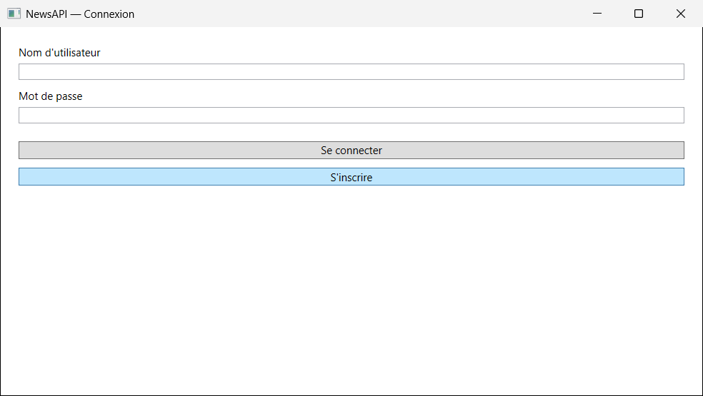
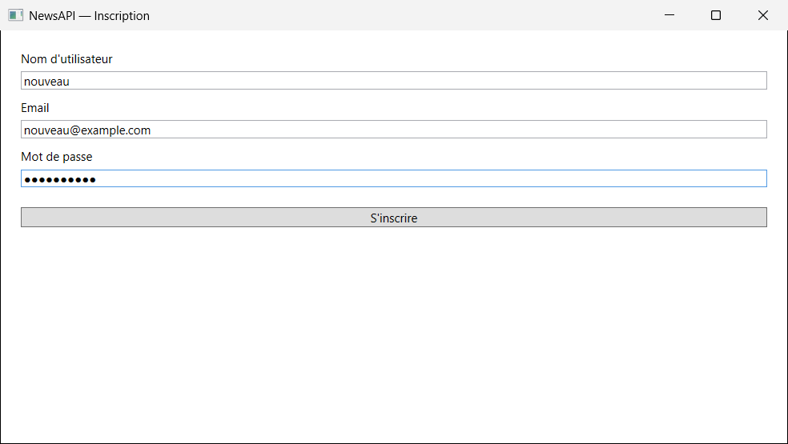
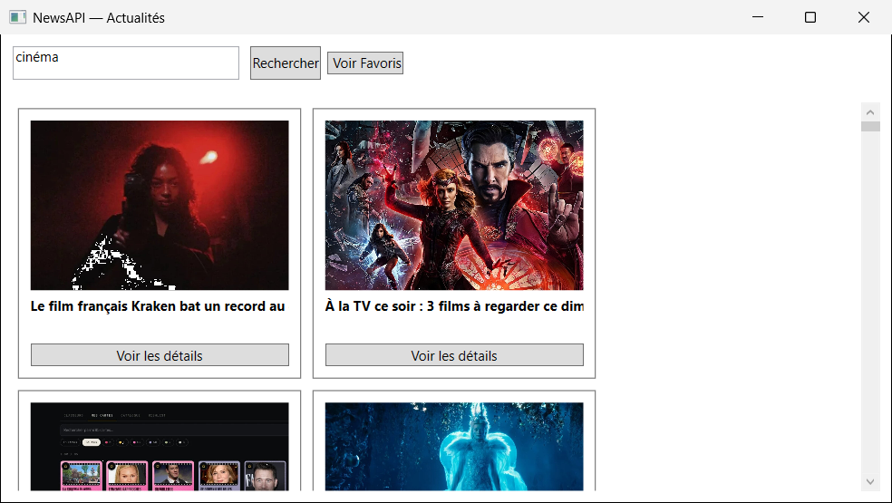
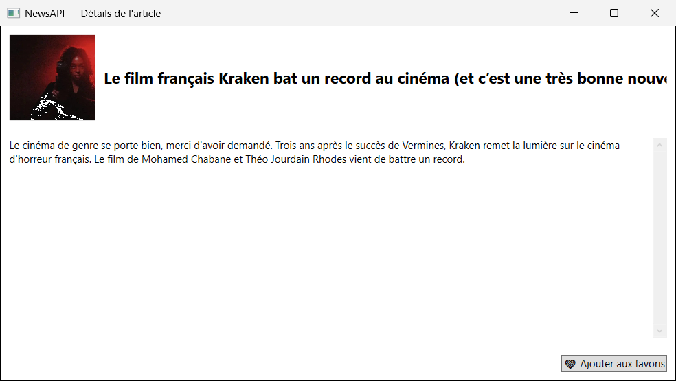
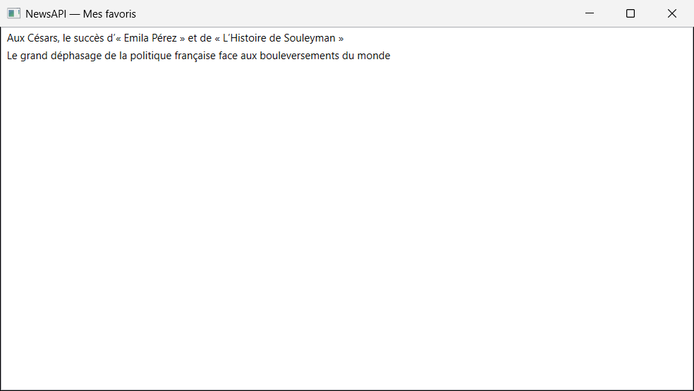

# NewsAPI — lecteur d'actualités

Application de bureau réalisée pendant mon **BTS SIO option SLAM** (2023–2025).

Elle affiche les actualités en français récupérées sur l'API REST [NewsAPI](https://newsapi.org) :
on tape un mot-clé, l'appli montre les articles sous forme de cartes (image + titre), et on peut ouvrir le détail
d'un article. Chaque utilisateur a un compte (inscription / connexion) et peut enregistrer des articles dans
ses **favoris**, stockés dans une base MySQL. Des triggers MySQL gardent un historique des ajouts et suppressions.

## Captures

| Connexion | Inscription |
|---|---|
|  |  |

| Recherche d'actualités | Détail d'un article |
|---|---|
|  |  |

| Mes favoris |
|---|
|  |

## Technologies

C#, WPF (.NET Framework 4.7.2), API REST NewsAPI (bibliothèque `NewsAPI`, appels asynchrones `async`/`await`),
MySQL avec le connecteur `MySql.Data` (requêtes paramétrées), triggers MySQL.
Mots de passe stockés hachés avec **BCrypt**.

## Installation

Prérequis : Windows, Visual Studio 2022 (charge de travail « Développement .NET Desktop »), MySQL 8,
et une **clé NewsAPI gratuite** (créer un compte sur https://newsapi.org/register).

1. Créer la base avec les données d'exemple :
   ```bash
   mysql -u root -p < database/newsapi.sql
   ```
   (ou onglet **Importer** de phpMyAdmin). Le script crée la base `newsapi`.
2. Copier `ProjetAPINews/secrets.config.example` en `ProjetAPINews/secrets.config`, puis y mettre :
   - **votre clé NewsAPI** à la place de `YOUR_NEWSAPI_KEY` ;
   - votre mot de passe MySQL à la place de `YOUR_PASSWORD`.

   `secrets.config` est ignoré par Git : la clé et le mot de passe ne sont jamais publiés.
   S'il manque, l'appli l'indique au démarrage.
3. Ouvrir `ProjetAPINews.sln` dans Visual Studio, puis lancer avec **F5**. Les paquets NuGet sont
   restaurés automatiquement.

## Comptes de démonstration

Mot de passe pour tous : `demo1234`

| Identifiant | Contenu |
|---|---|
| `demo` | 2 articles en favoris |
| `admin` | 1 article en favori |

On peut aussi créer son propre compte avec le bouton **S'inscrire**.

Les articles affichés appartiennent à leurs éditeurs ; l'appli ne fait que les lister via NewsAPI.

## Auteur

Mohamed FALL — [portfolio](https://mohafall.github.io) · [GitHub](https://github.com/MohaFall)
